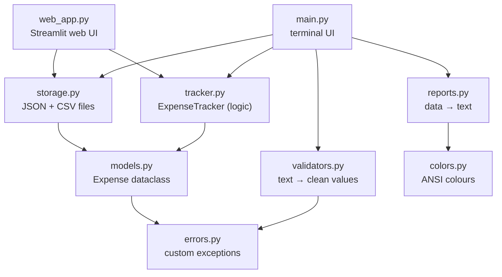

# 10 · Mini Project: Expense Tracker

An app to record daily expenses, see where your money goes, and export the data for analysis.
It comes with **two interfaces that share the same code**: a terminal app (`main.py`, standard library only) and a web app (`web_app.py`, built with Streamlit).
It is small enough to read in one sitting, but it is built the way real projects are: separate modules, input validation, safe saving, and **unit tests**.

**The terminal version:**

```
  OCTOBER 2026

  Spent    ₹18,940.00
  Budget   ₹25,000.00
  [███████████████░░░░░]  76% used · ₹6,060 left

  Where the money went

  bills      ██████████████████████████  50%  ₹9,539
  food       █████████████               26%  ₹4,860
  shopping   ██████                      12%  ₹2,301
  transport  ███                          7%  ₹1,280
  fun        ██                           3%  ₹600
  health     █                            2%  ₹360

  ★ Biggest expense: Rent share, ₹8,000
  ★ Daily average: ₹676
  ✓ You are within budget this month
```

In a real terminal, every category bar has its own colour.

---

## Quick start

No libraries needed. You only need Python 3.10 or newer.

```bash
cd 10_mini_project

python main.py --demo          # try it with 13 sample expenses
python main.py                 # start your own tracker
python main.py --budget 30000  # set your monthly budget
python main.py --help
```

Your data is saved to `data/expenses.json`, and the demo uses `data/demo.json`. To reset the demo, delete `data/demo.json`. The `data/` folder is in `.gitignore`, so your personal spending never goes to GitHub.

### Web version (Streamlit)

The web version needs one library, so install it inside a virtual environment (topic 08):

```bash
# from the repo root, once
python -m venv .venv
.venv\Scripts\activate              # Windows
source .venv/bin/activate           # macOS / Linux
pip install -r 10_mini_project/requirements.txt

# then, every time
cd 10_mini_project
streamlit run web_app.py
```

Your browser opens at `http://localhost:8501`. The web app reads and writes the **same** JSON files as the terminal app, so an expense you add in one shows up in the other.

| Area | What you get |
|------|--------------|
| Sidebar | Switch between demo and your own data, set the budget, add an expense with a form |
| Top row | Spent, budget left, daily average and biggest expense as metric cards, plus a budget progress bar |
| 📊 Summary tab | Bar chart by category, donut chart of shares, spending per day |
| 📋 All expenses tab | A table you can filter by category and search by description, with a **Download CSV** button |
| ⚙️ Manage tab | Delete an expense, with a confirmation checkbox |

## Terminal features

| # | Option | What it does |
|---|--------|--------------|
| 1 | Add expense | Asks for the amount, category, description and date. A wrong input is explained, then asked again |
| 2 | View all expenses | An aligned table sorted by date, with a total row |
| 3 | Filter by category | Only one category, plus its share of all spending |
| 4 | Monthly summary | Budget bar, coloured category bars, biggest expense, daily average |
| 5 | Delete expense | Deletes by ID, after a yes/no confirmation |
| 6 | Export to CSV | A file that `pandas.read_csv()` can open directly |
| 0 | Save and exit | Ctrl+C also saves safely |

---

## How the code is organised

Each file has **one job**. Only the two interface files (`main.py` and `web_app.py`) talk to the user. Everything else is plain logic, which is what makes it testable, and it is why adding a web UI didn't require changing a single line of the logic.



| File | Job | Read it to learn |
|------|-----|------------------|
| [errors.py](errors.py) | A family of custom exceptions | Exception hierarchies |
| [models.py](models.py) | The `Expense` dataclass, which validates itself | `@dataclass`, `__post_init__`, `@property`, `@classmethod` |
| [validators.py](validators.py) | Turns raw user text into clean values, or raises an error with a helpful message | Type conversion, `try`/`except`, `raise ... from None` |
| [tracker.py](tracker.py) | Adding, deleting, filtering and totals. No `input()` or `print()` | Classes, dunder methods, generators, `defaultdict` |
| [reports.py](reports.py) | Builds the text for every screen. Returns strings and never prints | f-string alignment, string building |
| [storage.py](storage.py) | Loading and saving JSON (safely) and exporting CSV | `pathlib`, `json`, `csv`, `with` |
| [colors.py](colors.py) | Coloured text with ANSI codes, switched off when output isn't a terminal | `sys`, `os`, environment variables |
| [main.py](main.py) | The menu loop, asking questions, command-line options | `match`/`case`, decorators, `argparse` |
| [web_app.py](web_app.py) | The Streamlit web interface: forms, metric cards, charts, table, download | Streamlit, a first taste of pandas, Altair charts |
| [sample_data.py](sample_data.py) | Demo data | |
| [tests/](tests/) | 41 tests (4 of them click through the web app) | `unittest`, `setUp`, `subTest`, `mock.patch`, Streamlit `AppTest` |

### Follow one action through the code: adding an expense

1. `main.py` → `App.run()` reads `"1"`, and `match` sends it to `add_expense()`.
2. `ask("Amount (₹): ", parse_amount)` calls `input()`. If `parse_amount` raises `InvalidAmountError`, the message is printed and the question is asked again.
3. The same happens for the category (`parse_category`) and the date (`parse_date`).
4. `tracker.add(...)` creates an `Expense`. Its `__post_init__` validates once more, so **an invalid expense can never exist**.
5. `add_expense` returns `True`, so the `@autosave` decorator calls `storage.save()`.
6. `save()` writes to `expenses.tmp` first, then renames it over `expenses.json`.

---

## Where each Python topic is used

| Topic | Concept | Where to look |
|-------|---------|---------------|
| [01 Basics](../01_basics/) | Type conversion, `math.isfinite` | `validators.parse_amount` |
| [02 Strings](../02_strings/) | f-string alignment `{x:>12}`, `.center()`, `"█" * n` | `reports.expense_table`, `reports.summary` |
| [03 Collections](../03_collections/) | Tuple of categories, `defaultdict`, sorting a dict | `models.CATEGORIES`, `tracker.totals_by_category` |
| [04 Control flow](../04_control_flow/) | `match`/`case` with `"0" \| "q" \| "exit"` | `main.App.run` |
| [05 Functions](../05_functions/) | Keyword-only args `*`, passing functions as arguments, lambdas | `tracker.filter`, `main.ask` |
| [06 OOP](../06_oop/) | Dataclass, `@property`, `@classmethod`, `@staticmethod`, `__len__`, `__iter__` | `models.Expense`, `tracker.ExpenseTracker` |
| [07 Errors & files](../07_errors_and_files/) | Custom exceptions, `raise from`, JSON, CSV, safe saving | `errors.py`, `storage.py` |
| [08 Modules](../08_modules_and_venv/) | Splitting code into modules, `__name__`, `argparse` | Every file, `main.main` |
| [09 Advanced](../09_advanced/) | Generator, decorator with `functools.wraps`, type hints | `tracker.filter`, `main.autosave` |

---

## Design decisions (and why)

These are the "why" answers an interviewer will ask about.

**Why is the logic separate from `input()` and `print()`?**
`tracker.py` and `reports.py` never touch the keyboard or the screen. That means they can be tested automatically, and the same `ExpenseTracker` could later power a web app or a Jupyter notebook without changes.

**Why do the `reports` functions return strings instead of printing?**
A function that returns a value can be checked in a test (`assertIn("76% used", text)`). A function that prints can't be checked easily.

**Why validate in two places (validators *and* the dataclass)?**
`validators.py` gives the user friendly messages while they type. `Expense.__post_init__` is the safety net that also protects against a hand-edited or corrupted JSON file.

**Why save to a `.tmp` file and then rename it?**
If the program crashed in the middle of writing `expenses.json`, you'd lose your data. A rename is a single, instant operation, so the file is always either the old version or the new one, never half of each.

**Why JSON for saving and CSV for export?**
JSON keeps the structure (the budget plus a list of expenses) and is easy for people to read. CSV is the format every data tool understands: Excel, pandas, Google Sheets.

**Why custom exceptions with a shared base class?**
`except ExpenseError` catches every "user typed something wrong" case in one place, but real bugs (a `TypeError`, say) still crash loudly so you notice them.

**Why turn colours off when the output isn't a terminal?**
In a file or a pipe, ANSI codes show up as junk like `[33m`. The app also respects the `NO_COLOR` environment variable.

**Why Streamlit for the web version, and not Flask or Tkinter?**
Streamlit turns a Python script into a web app with no HTML, CSS or JavaScript, and charts are built in. Flask is a *backend* framework: it would need separate HTML/CSS/JS files for the pages and a JavaScript library for the charts. Tkinter makes desktop windows and looks dated. For a data-focused app, Streamlit is the tool data scientists actually use.

**How does a Streamlit app work?**
Every click or keystroke re-runs `web_app.py` from top to bottom. So the file simply loads the data, draws the page, and saves after a change. `st.session_state` keeps small things (like the "Added #14" message) alive across reruns.

**What I deliberately left out:** a database, user accounts and a custom-designed website. They aren't needed at this size. Each one is an extension challenge below.

---

## Running the tests

```bash
cd 10_mini_project
python -m unittest -v
```

```
Ran 41 tests in 2.5s
OK
```

The tests use a temporary folder, so they never touch your real data. Read [tests/test_tracker.py](tests/test_tracker.py) first; it's the easiest one to follow.

The 4 web tests in [tests/test_web_app.py](tests/test_web_app.py) use Streamlit's `AppTest` to fill in the form and click buttons without a browser. If Streamlit isn't installed, they are skipped and the other 37 still run.

## Data format

`data/expenses.json`

```json
{
  "budget": 25000.0,
  "expenses": [
    {"id": 1, "date": "2026-10-01", "category": "bills", "description": "Rent share", "amount": 8000.0}
  ]
}
```

Dates are stored as ISO strings (`YYYY-MM-DD`). Screens show them as `DD-MM-YYYY`.

---

## Extend it yourself

These are ordered from easy to hard. Each one teaches something new. Write a test for each feature you add.

**Easy**
1. Add a new category, `education`, with its own colour.
2. Add menu option `7`: change the monthly budget from inside the app.
3. Show the 3 most recent expenses on the main menu.

**Medium**

4. Add an "Edit expense" option. (Hint: `dataclasses.replace`.)
5. Search by description: `"grocer"` should find "Groceries".
6. Let the summary pick any month, not only the latest.
7. Set a budget per category and warn when one goes over.

**Hard**

8. Recurring expenses: rent should be added automatically each month.
9. Replace JSON with **SQLite** (`sqlite3` is built in). Only `storage.py` should need to change. That's the reward for good structure.
10. Build a Flask API (`/expenses`, `/summary`) that reuses `tracker.py`, or deploy the Streamlit app for free on Streamlit Community Cloud.

---

## Interview practice: talk about this project

**"Walk me through your project."**
> "It's an expense tracker in Python with two interfaces, a terminal app and a Streamlit web app. I split it into modules by responsibility: a dataclass model, a tracker class for the business logic, a reports module that only builds text, and a storage module for JSON and CSV. Only the two UI files do input and output, so adding the web version didn't change any logic, and everything is covered by 41 tests. Expenses validate themselves in `__post_init__`, I used custom exceptions for user errors, and saving goes through a temporary file so a crash can't corrupt the data. The CSV export is the starting point for analysing the data with pandas."

**Likely follow-up questions:**
1. *How would you add a database?* Only `storage.py` would change, because the rest of the app only calls `load()` and `save()`.
2. *How do you test code that uses `input()`?* Keep the logic out of the input code (as here), or replace `input` with `unittest.mock.patch`.
3. *Why is `filter` a generator?* It doesn't build a list it might not need, and the caller decides whether to loop, count or convert it with `list()`.
4. *What happens if the JSON file is corrupted?* `load()` turns any parsing or validation error into a `StorageError`, the app shows a clear message, and it exits without overwriting the file.
5. *What's the time complexity of deleting an expense?* O(n), because it scans the list. A dict keyed by ID would make lookup O(1). That's fine for thousands of expenses and worth changing for millions.

---

## Next: Part 2, Data Science

Export your expenses (option 6), and in Part 2 we'll analyse the file with pandas:

```python
import pandas as pd

df = pd.read_csv("data/expenses.csv", parse_dates=["date"])
df.groupby("category")["amount"].sum().sort_values(ascending=False)
df.plot(kind="bar", x="category", y="amount")
```
