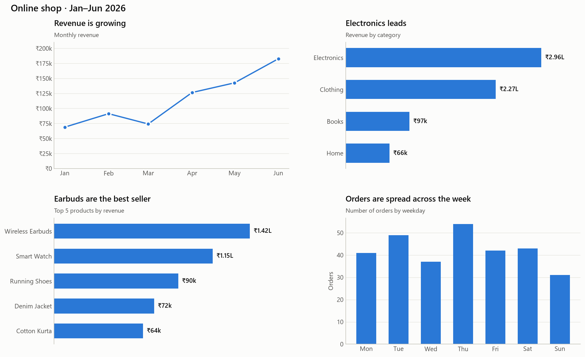
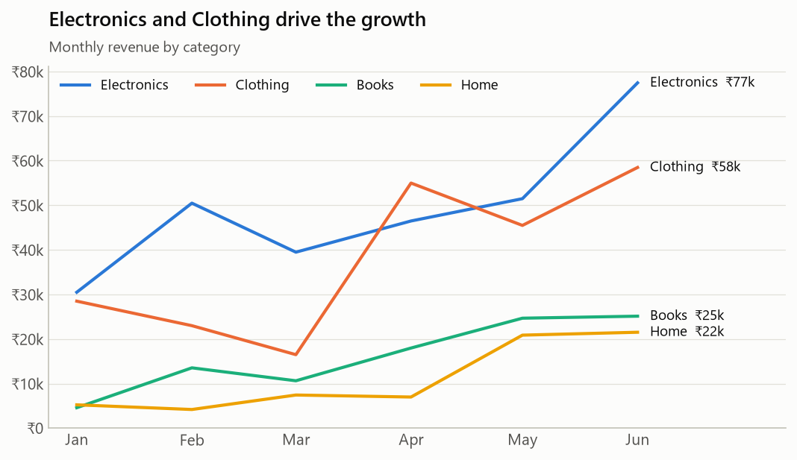
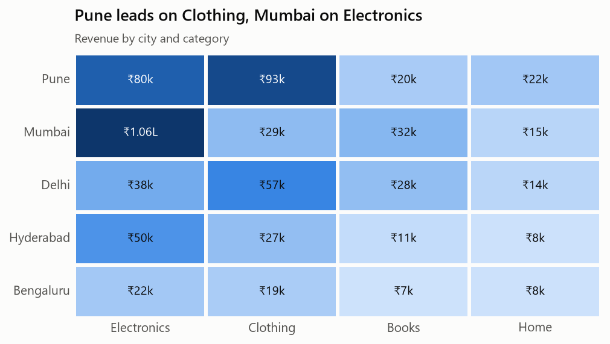

# 13 · Visualisation: Matplotlib & Seaborn

**👉 Start with the notebook: [visualisation_tutorial.ipynb](visualisation_tutorial.ipynb).** It turns the cleaned shop data from topic 12 into 12 charts, and GitHub shows them all.



To run it yourself:

```bash
.venv\Scripts\activate             # Windows; macOS/Linux: source .venv/bin/activate
pip install -r requirements.txt
cd 13_visualisation
jupyter notebook visualisation_tutorial.ipynb
```

| File | What it is |
|------|------------|
| [visualisation_tutorial.ipynb](visualisation_tutorial.ipynb) | The hands-on tutorial: 12 charts, each one explained |
| [chart_style.py](chart_style.py) | Shared colours and style used by every chart |
| [images/](images/) | Charts saved as PNG files |

---

## Matplotlib vs Seaborn

| | Matplotlib | Seaborn |
|---|---|---|
| What it is | The foundation: draws any chart, controls every pixel | Built **on top of** Matplotlib for statistical charts |
| Works with | Lists, arrays, Series | **DataFrames**: you name the columns |
| Strength | Total control, custom layouts | One line for histograms, box plots, heatmaps, grouping with `hue=` |
| You'll use it for | Fine-tuning any chart (titles, labels, axes) | Exploring data quickly |

You use them **together**: Seaborn draws the chart, and Matplotlib polishes it. Every Seaborn function accepts `ax=` and returns a Matplotlib Axes.

## 1. Figure and Axes

```python
import matplotlib.pyplot as plt

fig, ax = plt.subplots(figsize=(8, 4))   # Figure = the whole image, Axes = one chart
ax.plot(x, y)
ax.set_title("Revenue grew 2.7× from January to June")
ax.set_xlabel("Month")
fig.savefig("images/chart.png", dpi=150, bbox_inches="tight")

fig, axes = plt.subplots(2, 2)           # a 2×2 grid of charts
```

Always use this **object-oriented** style (`fig, ax = ...` then `ax.method()`), rather than calling `plt.plot()` everywhere. It stays clear when a figure has several charts.

## 2. Pick the chart from the question

| Your question | Chart | Matplotlib | Seaborn |
|---------------|-------|-----------|---------|
| How does it change over **time**? | Line | `ax.plot` | `sns.lineplot` |
| Which is **bigger**? | Bar | `ax.bar` / `ax.barh` | `sns.barplot` |
| How are values **spread**? | Histogram | `ax.hist` | `sns.histplot` |
| How do distributions **compare**? | Box plot | `ax.boxplot` | `sns.boxplot` |
| Are two numbers **related**? | Scatter | `ax.scatter` | `sns.scatterplot`, `sns.regplot` |
| How do **two categories** combine? | Heatmap | `ax.imshow` | `sns.heatmap` |
| What **share** of the whole? | Bar (or pie with ≤ 6 clear slices) | `ax.pie` | |
| Is it just **one number**? | No chart: show the number big | | |

## 3. Rules that make charts clear

These are the rules applied in the notebook. Each one fixes a real way charts mislead or confuse:

1. **The title states the takeaway.** "Revenue grew 2.7× from January to June" tells the reader what to see; "Monthly revenue" makes them work it out. Put *what is measured* in a smaller subtitle.
2. **Bars start at zero.** A bar's length *is* its value, so a cut-off axis exaggerates differences.
3. **Sort bars** from biggest to smallest, and use **horizontal bars** when the labels are words.
4. **One measure, one colour.** A bar chart of revenue by category is *one* series, so rainbow bars add nothing. Use different colours only when they mean different things.
5. **Colour follows the thing, not its position.** Electronics is blue in *every* chart (see `CATEGORY_COLORS` in [chart_style.py](chart_style.py)).
6. **Label selectively.** Label the last point, the biggest bar, or a line's end, not every single point.
7. **Quiet background.** Light, solid gridlines only on the axis you read values from; no top or right borders.
8. **Never two y-axes on one chart.** The alignment of two scales is arbitrary and can invent a relationship that isn't there. Draw two charts instead.
9. **Magnitude uses one hue, light → dark** (as in the heatmap). Never a rainbow.
10. **Don't rely on colour alone.** About 1 in 12 men has some colour blindness. Our palette was checked with a colour-blindness validator, and lines and categories also carry direct labels.
11. **Readable numbers.** `₹150k`, not `150000.0`. Axis ticks use one unit; labels can use lakh (`₹1.83L`).

## 4. Seaborn in practice

```python
import seaborn as sns

sns.histplot(data=df, x="revenue", binwidth=500)                 # distribution
sns.boxplot(data=df, x="category", y="revenue")                  # compare distributions
sns.barplot(data=df, x="revenue", y="category", estimator="sum", errorbar=None)  # it does the groupby
sns.regplot(data=daily, x="orders", y="revenue")                 # scatter + trend line
sns.heatmap(table, annot=True, cmap="Blues")                     # colour-coded table
sns.lineplot(data=df, x="month", y="revenue", hue="category")    # one line per category
```

- `hue="column"` splits the data by a column and gives each group its own colour.
- `estimator="sum"`: Seaborn's `barplot` shows the **mean** by default, so set it when you want totals.
- `errorbar=None` hides the confidence-interval lines (they're covered in topic 14).

## 5. Reading the charts: what we found





- Revenue grew **2.7×** from January to June, driven by **Electronics and Clothing**.
- Order values are **right-skewed**: the median is ₹1,497, but the mean is ₹2,308, because a few big orders pull it up.
- **Mumbai** buys the most Electronics, while **Pune** leads on Clothing.
- Days with more orders earn more (**r = 0.64**), but one big order can outweigh several small ones.

## Common mistakes

- Calling `plt.plot()` repeatedly without `fig, ax`, so charts end up drawn on top of each other.
- Forgetting `plt.show()` in scripts, or saving *after* `plt.show()` (which can give a blank file). Call `savefig` first.
- Pie charts with many slices or similar sizes.
- A y-axis on a bar chart that doesn't start at 0.
- Default labels like `1e6` or `150000.0`. Use a formatter.
- A different colour for the same category in different charts.
- Seaborn `barplot` showing the **mean** when you expected the **sum**.
- Overlapping labels. Always **look at the saved image** before sharing it.

---

## Interview questions

**1. What is the difference between Matplotlib and Seaborn?**
Matplotlib is the low-level plotting library that controls every element. Seaborn is a high-level library built on it that works directly with DataFrames, handles grouping (`hue`) and statistics, and has good defaults. In practice you use Seaborn for the chart and Matplotlib to customise it.

**2. What is the difference between a Figure and an Axes?**
The Figure is the whole canvas. An Axes is one plot inside it, with its own axes, title and data. One Figure can hold many Axes (`plt.subplots(2, 2)`).

**3. When would you use a histogram vs a bar chart?**
A histogram shows the **distribution of one numeric variable** by grouping values into bins, so the bars touch. A bar chart compares a value across **categories**, and the order of the bars can be changed.

**4. How do you read a box plot?**
The box covers the middle 50% of the data (from Q1 to Q3, the IQR), and the line inside is the median. The whiskers extend to the furthest points within 1.5 × IQR, and the points beyond them are drawn as outliers.

**5. Why might a pie chart be a bad choice?**
People compare angles and areas poorly, so similar slices look the same. A pie also can't show more than a handful of categories. A sorted bar chart makes comparisons easy.

**6. Why should bar charts start at zero?**
The length of the bar encodes the value. Starting at, say, 90 makes 95 look twice as big as 92.5. (Line charts can sometimes zoom in, because they show change, not size.)

**7. What's wrong with dual-axis charts?**
The two scales can be stretched independently, so the lines can be made to cross, diverge or overlap at will. The apparent relationship is a choice by the chart's author, not a fact in the data. Use two charts, or index both series to a common starting point.

**8. How would you visualise the relationship between two numeric variables?**
A scatter plot, with a trend line (`sns.regplot`) and the correlation coefficient. For many points, use transparency or a hexbin/density plot.

**9. How do you make charts accessible to colour-blind readers?**
Use a validated colour-blind-safe palette, don't rely on colour alone (add labels, patterns or markers), keep good contrast, and offer the data as a table as well.

**10. What chart would you use to show sales by region over 12 months?**
A line chart with one line per region (up to about 5 lines, labelled directly), or small multiples (one small chart per region on a shared axis) if there are more regions.

---

## Practice

Use `../12_pandas/data/sales_clean.csv` and `chart_style.py`:

1. Draw a bar chart of the **number of orders** per city, sorted, with value labels.
2. Plot monthly revenue for **Pune only** as a line chart with a takeaway title.
3. Make a histogram of `quantity`. What does its shape tell you?
4. Use `sns.boxplot` to compare order values across **payment methods**. Is cash used for bigger or smaller orders?
5. Create a heatmap of **number of orders** by weekday and month.
6. Build your own 1×3 dashboard and save it as `images/my_dashboard.png`.
7. **Challenge:** add a chart to the Expense Tracker's Streamlit app (topic 10) showing spending per weekday.
