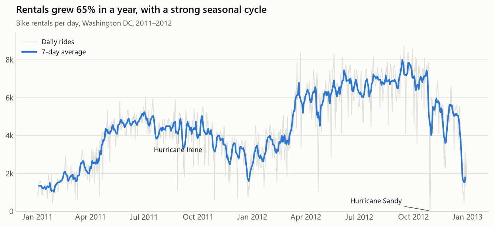
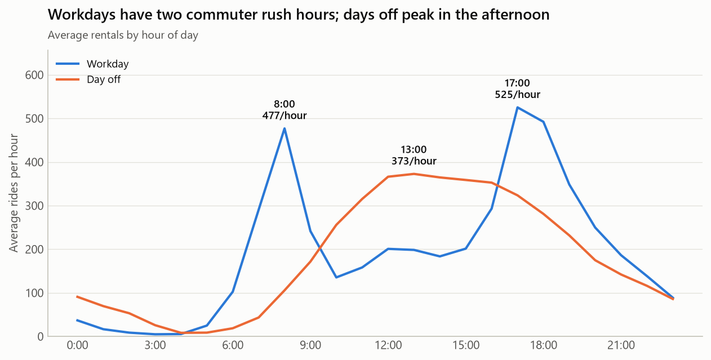
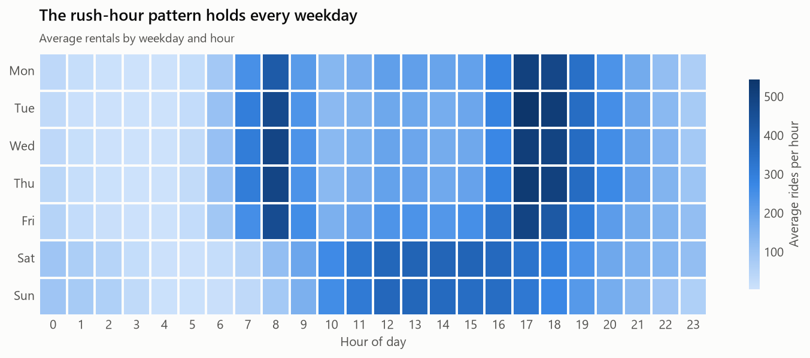
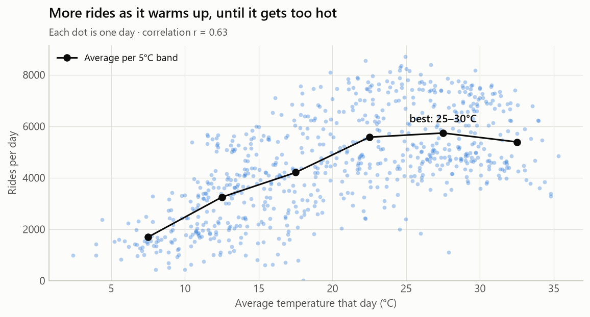

# 15 · EDA Project: What Drives Bike Rentals in Washington DC?

An exploratory data analysis of **17,379 hours** of real bike-sharing data from Capital Bikeshare (2011–2012), joined with weather records.

**📓 Full analysis: [bike_sharing_eda.ipynb](bike_sharing_eda.ipynb)**. It shows every step with code, charts and reasoning, and it renders on GitHub.



---

## The business problem

A bike-sharing company needs bikes **where and when** people want them, and wants to repair bikes when demand is low. That requires understanding the patterns behind demand:

1. Is the data trustworthy?
2. How did demand change over the two years?
3. How do seasons affect rentals?
4. How does demand change through the day?
5. Do casual riders and members behave differently?
6. How much does the weather matter?

## Key findings

### 1. Rentals grew 65% in one year
2011 had 1.24 million rides and 2012 had 2.05 million. 2012 was higher in **every single month**, so the growth was across the board. Demand peaks from May to October; winter has about **half** of summer's demand.

### 2. Workdays have two rush hours; days off have one afternoon peak



On workdays, demand spikes at **8:00 (477 rides/hour)** and **17:00 (525/hour)**: commuters. On days off, there's one broad peak around **13:00**. The pattern is the same on all five weekdays:



### 3. The total hides two different kinds of riders
Workdays and days off have similar **totals** (4,585 vs 4,330 rides a day; not a significant difference, p = 0.12). But on days off, **casual riders more than double** (607 → 1,371 a day) while **registered members drop** by a quarter. Members (81% of rides) are commuters; casual riders ride for leisure.

### 4. Temperature is the strongest driver; rain cuts demand in half



Rentals climb steadily with temperature (r = 0.63) up to **25–30 °C**, then dip a little on the hottest days. Days where rain or snow was the main weather have **54% fewer** rentals.

### 5. The data had problems that a careless analysis would miss
- **The data dictionary is wrong:** it says season 1 = spring, but season 1 actually covers **December–March** (winter).
- **165 hours are missing.** Two clusters match **Hurricane Irene** (Aug 2011) and **Hurricane Sandy** (Oct 2012, when only 22 rides were recorded in a day).
- **A broken humidity sensor** reported 0% humidity for a whole day (10 March 2011). Those values were set to missing.

## Recommendations

| # | Recommendation | Based on |
|---|----------------|----------|
| 1 | **Rebalance bikes before rush hours**: residential areas before 8:00, business districts before 17:00 | The commuter peaks |
| 2 | **Schedule maintenance** overnight (0:00–5:00), on rainy days and in winter | The lowest-demand periods |
| 3 | **Target casual weekend riders** with membership offers | 2.3× more casual riders on days off |
| 4 | **Forecast demand** from hour, workday, temperature, weather and the growth trend | The strongest drivers found here (→ topic 16) |

## Limitations

- Only two years and one city, so the 65% growth may not continue.
- Weather is city-wide, not per station.
- There's no station-level data, so this tells us **when** bikes are needed but not **where**.
- Holidays (21 days) and severe weather are rare, so conclusions about them are less certain.
- Correlation is not causation: temperature, season and daylight all rise together.

---

## How the analysis was done

| Step | What | Tools |
|------|------|-------|
| 1. Understand | Read the data dictionary, then **verify** it against the data | pandas `groupby` |
| 2. Clean | Readable column names, decode categories, convert units back from the 0–1 scale, flag impossible values | pandas |
| 3. Quality checks | Missing values, duplicates, missing hours, totals that add up | pandas |
| 4. Explore | Trends, seasonality, hourly patterns, user groups, weather | pandas, Matplotlib, Seaborn |
| 5. Test | Is a difference real or chance? | SciPy (Mann-Whitney, Kruskal-Wallis) |
| 6. Communicate | Takeaway titles, findings, recommendations, limitations | This README |

**What makes a good EDA** (and what this project tries to show):
- **Start from questions**, not from "let's plot everything".
- **Check the data before trusting it**, including the documentation.
- **Break totals into groups.** An average can hide opposite behaviours.
- **State your definitions.** "Rainy day" means one thing if rain was the main weather (54% fewer rides) and another if a single rainy hour counts (20% fewer). The notebook shows both.
- **Be honest about uncertainty and limits.**
- **End with actions**, not just charts.

## Files

| File | What it is |
|------|------------|
| [bike_sharing_eda.ipynb](bike_sharing_eda.ipynb) | The full analysis |
| [data/hour.csv](data/hour.csv), [data/day.csv](data/day.csv) | Original data (hourly and daily) |
| [data/Readme.txt](data/Readme.txt) | The original data dictionary |
| [data/bike_hourly_clean.csv](data/bike_hourly_clean.csv) | Cleaned hourly data, used by topic 16 |
| [images/](images/) | Charts used in this README |

To run it yourself:

```bash
.venv\Scripts\activate             # Windows; macOS/Linux: source .venv/bin/activate
pip install -r requirements.txt
cd 15_eda_project
jupyter notebook bike_sharing_eda.ipynb
```

## Interview practice: present this project

**"Tell me about a data analysis project you've done."**
> "I analysed two years of hourly bike-sharing data from Washington DC to understand what drives demand. Before analysing, I checked the data and found that the documentation mislabelled the seasons, that 165 hours were missing (two clusters matched hurricanes), and that a humidity sensor had failed for a day. The main findings were 65% year-on-year growth, two commuter rush hours on workdays versus a single afternoon peak on days off, and that temperature and rain were the strongest weather effects. The most interesting insight was that total demand looked the same on workdays and weekends, but the mix of riders was completely different: casual riders more than doubled on days off. I turned that into four recommendations, including rebalancing bikes before rush hours and targeting weekend casual riders for memberships."

**Likely follow-up questions:**
1. *How did you decide what counts as a "rainy day"?* I used the most common weather of the day, and showed that a looser definition changes the effect from 54% to 20%.
2. *How do you know the weekend difference isn't just chance?* A Mann-Whitney test: totals aren't significantly different (p = 0.12), but casual rides are (p < 0.001).
3. *What would you do with more time?* Get station-level data to answer *where* bikes are needed, and build a forecasting model (that's the next project).
4. *What would make you doubt your conclusions?* Only two years of data from a fast-growing system, and city-wide weather rather than per-station weather.

---

## Data source and citation

Bike Sharing Dataset, UCI Machine Learning Repository. Licensed under [CC BY 4.0](https://creativecommons.org/licenses/by/4.0/). [Dataset page](https://archive.ics.uci.edu/dataset/275/bike+sharing+dataset).

> Fanaee-T, Hadi, and Gama, Joao. "Event labeling combining ensemble detectors and background knowledge." *Progress in Artificial Intelligence* (2013): pp. 1–15, Springer Berlin Heidelberg. doi:[10.1007/s13748-013-0040-3](https://doi.org/10.1007/s13748-013-0040-3)

The original data comes from Capital Bikeshare's public system data, with weather from freemeteo.com.
