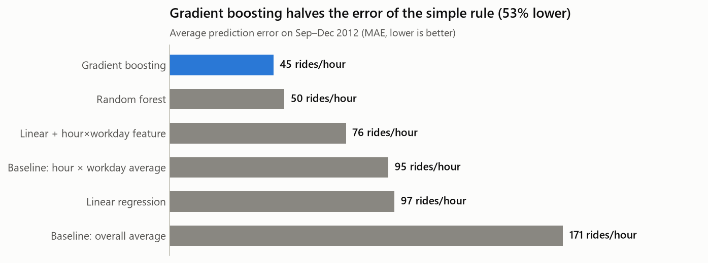
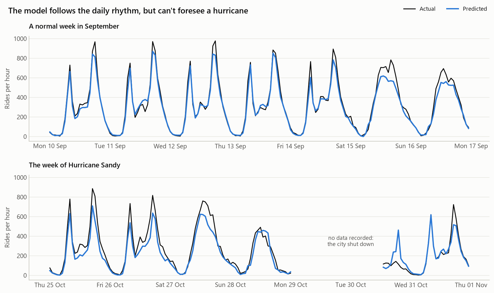

# 16 · Machine Learning: Predicting Bike Demand

**👉 Start with the notebook: [bike_demand_model.ipynb](bike_demand_model.ipynb).** Using the bike-sharing data explored in [topic 15](../15_eda_project/), it builds a model that predicts **how many bikes will be rented in a given hour**, so the company can plan bikes and staff in advance.



## Results

| Model | MAE (rides/hour) | R² |
|-------|-----------------|-----|
| Baseline: always the average | 171 | −0.08 |
| Baseline: average per hour × workday | 95 | 0.60 |
| Linear regression | 97 | 0.63 |
| Linear + an hour×workday feature | 76 | 0.78 |
| Random forest | 50 | 0.88 |
| **Gradient boosting** | **45** | **0.90** |

Tested honestly on **September–December 2012**, which the models never saw. The average hour in that period had 240 rides.



## Use the model

```bash
.venv\Scripts\activate                    # Windows; macOS/Linux: source .venv/bin/activate
pip install -r requirements.txt

python 16_machine_learning/predict.py --hour 8 --day Tuesday --temp 22 --weather Clear
# Tuesday (workday) 8:00, 22°C, Clear: about 736 rides

python 16_machine_learning/predict.py --hour 14 --day Saturday --temp 26
python 16_machine_learning/predict.py --help
```

The first run trains and saves the model (a few seconds). The `models/` folder is git-ignored, because model files are generated, and pickle files shouldn't be shared blindly (see "Security" below).

| File | What it is |
|------|------------|
| [bike_demand_model.ipynb](bike_demand_model.ipynb) | The full tutorial: baselines → models → evaluation → traps → saving |
| [features.py](features.py) | Feature lists and preprocessing, shared by everything below |
| [train.py](train.py) | Trains the final model on **all** data and saves it |
| [predict.py](predict.py) | Command-line predictions for any hour |
| [images/](images/) | Charts used in this README |

---

## Machine learning in one page

### What is it?
Instead of writing rules by hand ("8 am on a workday → 500 rides"), you give the computer **examples** and it **learns** the rules.

| Type | Learns from | Predicts | Example |
|------|------------|----------|---------|
| **Supervised: regression** | Examples **with answers** | A **number** | Rides per hour (this project), house prices |
| **Supervised: classification** | Examples **with answers** | A **category** | Spam or not, will a customer leave |
| **Unsupervised** | Examples **without answers** | Groups or structure | Customer segments, anomaly detection |

**Features (X)** are the inputs, and the **target (y)** is what you want to predict.

### The workflow

```
1. Define the problem and the metric
2. Prepare features (only what's known at prediction time!)
3. Split: train on the past, test on the future
4. Baseline: a simple rule the model must beat
5. Train models (start simple)
6. Evaluate on the test set, then look beyond the single number
7. Tune with cross-validation (on training data only)
8. Explain: which features matter?
9. Retrain on all data, save, and use
```

### scikit-learn's consistent API

Every model works the same way, which makes it easy to try several:

```python
model = RandomForestRegressor()
model.fit(X_train, y_train)          # learn
predictions = model.predict(X_test)  # use
```

**Pipelines** chain preprocessing and the model into one object:

```python
model = make_pipeline(ColumnTransformer([...]), HistGradientBoostingRegressor())
```

Use pipelines because:
1. The preprocessing learns **only from the training data**, so there's no leakage.
2. One `fit` and one `predict` do everything.
3. You can save **one file** that does it all.

### Overfitting and underfitting

| | Underfitting | Good fit | Overfitting |
|---|---|---|---|
| What | Too simple to capture the pattern | Captures the real pattern | Memorises the training data, including noise |
| Training error | High | Low | **Very low** |
| Test error | High | Low | **High** |
| Example | A straight line for a rush-hour curve | Gradient boosting here | A huge tree that remembers every hour |
| Fix | A more flexible model, better features | — | More data, simpler model, regularisation, cross-validation |

This is the **bias–variance trade-off**: simple models have high bias (they're consistently wrong in the same way), and complex models have high variance (they change a lot with small changes in the data).

### Regression metrics

| Metric | Meaning | Use when |
|--------|---------|----------|
| **MAE** | The average absolute error | You want a number anyone understands ("off by 45 bikes on average") |
| **RMSE** | Like MAE, but large errors count more | Big mistakes are especially costly |
| **R²** | Share of the variation explained (1 = perfect, 0 = no better than the mean) | Comparing across problems |

### Common model types

| Model | How it works | Strengths | Weaknesses |
|-------|-------------|-----------|------------|
| Linear regression | A weighted sum of the features | Fast, easy to explain | Misses interactions and curves unless you engineer features |
| Decision tree | A flowchart of yes/no questions | Easy to explain, finds interactions | One tree overfits easily |
| Random forest | Many trees on random subsets, averaged | Robust, little tuning needed | Larger, slower, can't extrapolate |
| Gradient boosting | Trees added one by one, each fixing the previous errors | Often the best on tabular data | More settings to tune |

---

## Lessons from this project

1. **Always start with a baseline.** Our simple "average per hour and day type" rule reached R² = 0.60, and plain linear regression barely beat it.
2. **Domain knowledge beats blind modelling.** One feature from the EDA (hour × workday) cut linear regression's error from 97 to 76.
3. **Trees find interactions automatically.** Gradient boosting halved the simple rule's error.
4. **Split time data by time.** A random split gave MAE 25 instead of the honest 45, making the model look **45% better** than it really is.
5. **Watch for leakage.** Including the `registered` column gave R² = 0.99, and the model would be useless in reality, because that number isn't known in advance.
6. **Tuning is a small gain.** Here the tuned model was even slightly worse on the test set, so we kept the simpler one.
7. **A model only knows its features.** It predicted a normal day during Hurricane Sandy.
8. **Every metric has blind spots.** Permutation importance showed `year` at 0, only because the whole test period is 2012.
9. **Types matter.** True/False columns mixed with numbers once broke prediction on new data. The fix (converting inside the pipeline, in `features.py`) means training and prediction always match.

## Security: model files

`joblib` and `pickle` files **can run code when they're loaded**. Only load models you created yourself or fully trust. Never load a `.pkl` or `.joblib` file from an unknown source. That's why this repo doesn't ship the trained model: `predict.py` trains it locally from the data.

---

## Interview questions

**1. What's the difference between supervised and unsupervised learning?**
Supervised learning trains on examples with known answers (labels) to predict those answers for new data, as in regression and classification. Unsupervised learning finds structure in data without labels, as in clustering and dimensionality reduction.

**2. What's the difference between regression and classification?**
Regression predicts a continuous number (rides per hour). Classification predicts a category (spam or not spam).

**3. Why do we split data into training and test sets?**
To measure how the model performs on data it has never seen, which is what matters in real use. Evaluating on the training data rewards memorisation.

**4. Why not split time-series data randomly?**
Neighbouring time points are very similar, so a random split lets the model "peek" at the hours around each test hour. Train on the past and test on the future, and use `TimeSeriesSplit` for cross-validation.

**5. What is data leakage? Give an example.**
When the training features contain information that wouldn't be available at prediction time, or information derived from the target. Example: using `registered` riders to predict total rides, or scaling the data using statistics from the test set.

**6. What is overfitting, and how do you detect and prevent it?**
The model learns noise in the training data and does poorly on new data. You detect it by a large gap between training and validation scores. Prevent it with more data, simpler models, regularisation, early stopping, or limiting tree depth and leaf size.

**7. What is cross-validation?**
Training and validating several times on different splits of the training data, then averaging the scores. It gives a more reliable estimate than a single split and is used to choose hyperparameters.

**8. MAE vs RMSE: which would you use?**
MAE when every error counts equally and you want an easy-to-explain number. RMSE when large errors are disproportionately costly, because it squares the errors before averaging.

**9. Why use a Pipeline in scikit-learn?**
It ensures preprocessing is fitted only on the training data (no leakage), keeps training and prediction identical, works with cross-validation and grid search, and can be saved as one object.

**10. How does a random forest differ from gradient boosting?**
A random forest trains many trees **independently** on random samples and averages them, which reduces variance. Gradient boosting trains trees **one after another**, each correcting the errors of the ones before, which reduces bias. Boosting often scores higher but needs more careful tuning.

**11. What is feature importance, and what are its pitfalls?**
A measure of how much a model relies on each feature. Permutation importance shuffles a feature and measures how much the error increases. Pitfalls: correlated features share importance, it only reflects features that vary in the evaluation data, and importance is not causation.

**12. Your model scores R² = 0.99. What do you do?**
Be suspicious. Check for leakage (features derived from the target or from the future), check the split (random splits on time data), and check whether the test set accidentally overlaps with training.

---

## Practice

1. Add a feature `is_rush_hour` (7–9 and 16–19 on workdays) and retrain linear regression. How much does it help?
2. Try `HistGradientBoostingRegressor(loss="poisson")`, which is designed for counts. Does MAE improve?
3. Predict **casual** and **registered** riders with two separate models, then add the predictions together. Is that better than predicting the total directly?
4. Change the test period to **May–August 2012** (summer). How does the error change, and why?
5. Turn it into a **classification** problem: predict whether an hour is "busy" (more than 400 rides). Use `HistGradientBoostingClassifier` and report accuracy, precision and recall.
6. Add the model to the Streamlit idea from topic 10: build a small app with sliders for hour and temperature that shows the predicted rides.
