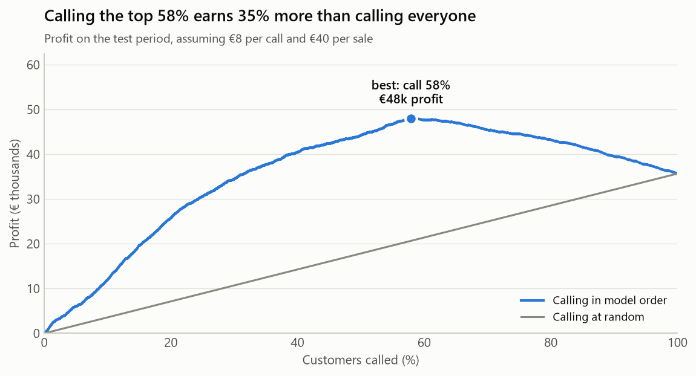
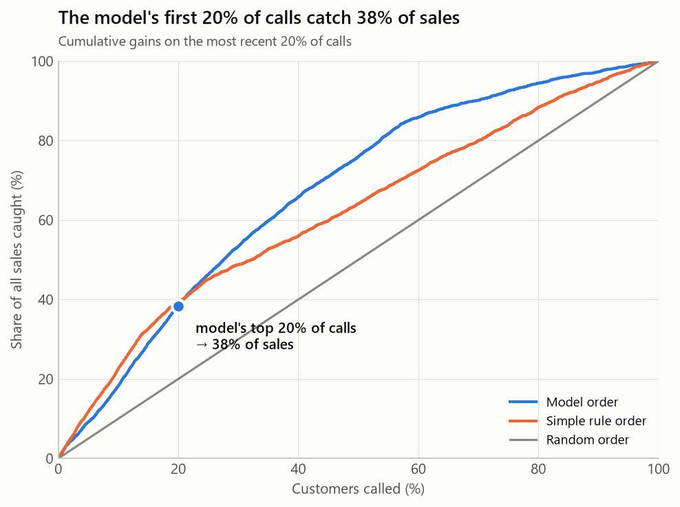
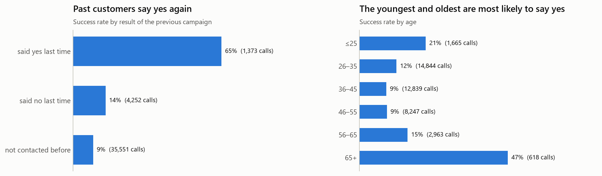
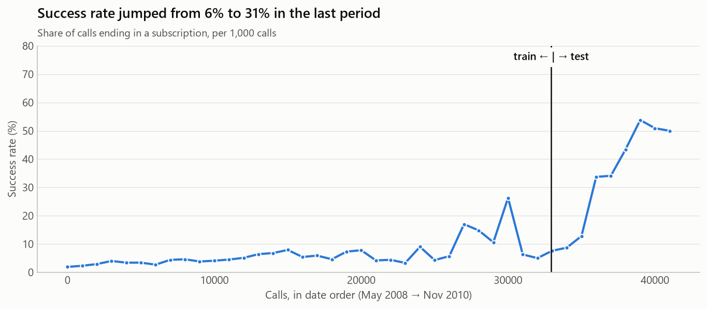

# 17 · Capstone: Who Should the Bank Call?

**An end-to-end data science project:** a real dataset → data audit → exploration → statistics → machine learning → business decision → an interactive app.

A Portuguese bank sells term deposits by phone. Only about 1 in 9 calls ends in a sale, and every call costs agent time. This project builds a model that **ranks customers by their chance of saying yes**, works out **how many calls are worth making**, and puts it all in an app a campaign manager can use.

| | |
|---|---|
| 📓 **Analysis** | [capstone_analysis.ipynb](capstone_analysis.ipynb): the full story with code and charts |
| 📞 **App** | [app.py](app.py): Streamlit campaign planner |
| 🧠 **Model code** | [bank_model.py](bank_model.py): data, features and model, shared by everything |
| ✅ **Tests** | [tests/](tests/): 13 tests, including clicking through the app |



---

## Results at a glance

| | |
|---|---|
| **Ranking quality** | ROC AUC **0.75** on calls from a later period the model never saw |
| **Top 20% of calls** | Catch **38%** of all sales, **1.9×** better than calling at random |
| **Recommended plan** | Call the top **58%** of customers: **42% fewer calls**, **85% of the sales** |
| **Profit** *(assuming €8 per call, €40 per sale)* | **€48k** vs €36k for calling everyone (**+35%**) |



## Key findings

**1. Past customers are the best prospects.** People who said yes in an earlier campaign said yes again **65%** of the time, versus 9% for customers never contacted before.



**2. The youngest and oldest respond best.** Under-26s (21%) and over-65s (47%) are far above the 9–12% of middle-aged customers, a U-shape that a single linear "age" feature can't capture, so the model uses age bands.

**3. The world changed during the data.** After the 2008 financial crisis, the bank made fewer, better-targeted calls, and the success rate jumped from **6% to 31%**. The economic indicators in the latest period are outside anything seen before. This **dataset shift** decided which model won.



**4. The simpler model generalised better.** With a random train/test split, gradient boosting looked best (AUC 0.80). Tested honestly on the *future*, it collapsed to 0.64, because trees can't extrapolate to economic conditions they've never seen. Logistic regression held up at 0.75.

**5. A simple rule is a strong baseline.** "Call past successes, students, retirees and over-65s first" matches the model for the first ~20% of calls. The model's value is in ranking the **large middle** of the list: it earns **€48k vs €37k** at the best call volume.

## How the project was done

| Step | What | Lesson |
|------|------|--------|
| 1. Define success | Ranking quality and **profit**, not accuracy (predicting "no" for everyone is 89% accurate and useless) | Choose the metric before the model |
| 2. Data audit | 12 duplicates; missing values hidden as `"unknown"` and `pdays = 999` | Placeholders are missing data too |
| 3. Leakage check | Dropped `duration` (call length) and `campaign` (contacts including the last one): both are only known **after** the call. Keeping them fakes AUC 0.82 | Ask "would I know this at prediction time?" |
| 4. Explore | Previous outcome, age, job, contact type, the economy | The EDA guides the features |
| 5. Statistics | Chi-square tests: every effect is significant. With 41k rows, size matters more than p-values | Significance ≠ importance |
| 6. Features | `contacted_before` instead of the 999 placeholder; age bands for the U-shape | Make the data say what it means |
| 7. Models | Random order, a simple rule, logistic regression, gradient boosting, on a **time-based split** | Test the way the model will be used |
| 8. Business value | Gains chart and profit curve with adjustable costs | Turn scores into a decision |
| 9. Explain | Odds ratios from logistic regression, with the caveats | Read coefficients carefully |
| 10. Fairness | The model would call 98% of over-65s but 46% of 36–45-year-olds | Review sensitive features before real use |
| 11. Ship | A Streamlit app and tests for both the model and the app | A model is only useful when someone can use it |

## The app

```bash
cd C:\Users\Sangita\Development\python          # the repo root
.venv\Scripts\activate                          # macOS/Linux: source .venv/bin/activate
pip install -r requirements.txt
cd 17_capstone
streamlit run app.py
```

- **Sidebar:** set the cost per call and the value of a sale. The app recommends how many customers to call, and you can override it with a slider.
- **Headline numbers:** calls, sales (vs random order), success rate and profit (vs calling everyone).
- **📈 Plan:** an interactive profit curve plus a plain-language summary of the plan.
- **📋 Call list:** the customers to call, ranked, with a CSV download.
- **🔎 Score a customer:** enter a customer's details and see their chance of saying yes and their place in the list.

The app replays the **most recent 20%** of the bank's calls as "the next campaign". The model never saw those customers in training, so every number is an honest **backtest**. The first run trains the model (a few seconds). The `models/` folder is git-ignored, because trained models are generated files and pickle files should never be shared blindly.

## Tests

```bash
cd 17_capstone
python -m unittest -v
```

13 tests check the features (`999` → `contacted_before`, age band edges, no leaky columns), the time split, the model's quality on future data, the profit maths, and the app itself. Using Streamlit's `AppTest`, they change the costs, move the slider, and score customers.

**The tests caught a real bug.** The app's "score a customer" form looked up "today's economic conditions" from the *last row* of the customer table, but that table is sorted by probability, so the last row was the *least likely* customer, from an old period. A past "yes" customer scored lower than a new one. The test now checks that a past "yes" scores above a new customer, and a new customer above a past "no".

## Limitations and next steps

- **Dataset shift:** the latest period differs a lot from the past. Retrain regularly and monitor the success rate.
- **Probabilities are too low for the new period** (the model predicts 27% on average, while 31% actually said yes). Fine for *ranking*; recalibrate before using the probabilities as real chances.
- **Costs and values are assumptions.** Replace them with the bank's real numbers.
- **The month feature partly encodes time,** not just seasonality, so don't read "October is the best month" as a fact.
- **Fairness:** age and job improve targeting but need a compliance review. Use scores to order calls, never to deny products.
- **Next:** a hybrid (past successes first, then the model), and an **A/B test** (topic 14) of model-ordered calling against the current approach.

---

## Interview practice: present this project

**"Walk me through your capstone."**
> "I built a model to help a bank decide whom to call in a telemarketing campaign, using 41,000 real calls. I first defined success as ranking quality and profit, because accuracy is useless when only 11% say yes. In the data audit I found placeholder missing values and two leaky columns, call duration and the campaign contact count, which are only known after the call. The most important discovery was a big dataset shift after the 2008 crisis: the success rate went from 6% to 31%. Because of that, I tested on a time-based split, and it changed the model choice: gradient boosting looked best on a random split but failed on the future, while logistic regression generalised. The model's first 20% of calls catch 38% of sales, and with assumed costs, calling the top 58% earns about a third more than calling everyone. I shipped it as a Streamlit app with tests, and the tests caught a real bug in the app."

**Likely follow-up questions:**
1. *Why not accuracy?* With 11% positives, predicting "no" for everyone is 89% accurate. Ranking metrics and profit match the business decision.
2. *Why did the simpler model win?* Trees can't extrapolate beyond the feature values they've seen, and the test period's economy was outside the training range.
3. *How did you choose how many people to call?* From the profit curve: keep calling while the expected value of the next call exceeds its cost. The app lets the business change the cost and value assumptions.
4. *A simple rule did as well at the top. Why use a model?* The rule only separates a few groups. The model ranks everyone, which matters when the profitable plan is to call over half the list.
5. *What are the risks?* Dataset shift, uncalibrated probabilities, assumed costs, and fairness concerns around age and job.

---

## Data source and citation

Bank Marketing dataset, UCI Machine Learning Repository. Licensed under [CC BY 4.0](https://creativecommons.org/licenses/by/4.0/). [Dataset page](https://archive.ics.uci.edu/dataset/222/bank+marketing).

> S. Moro, P. Cortez and P. Rita. "A Data-Driven Approach to Predict the Success of Bank Telemarketing." *Decision Support Systems* 62 (2014): 22–31. doi:[10.1016/j.dss.2014.03.001](https://doi.org/10.1016/j.dss.2014.03.001)

The original data dictionary is in [data/bank-additional-names.txt](data/bank-additional-names.txt).
